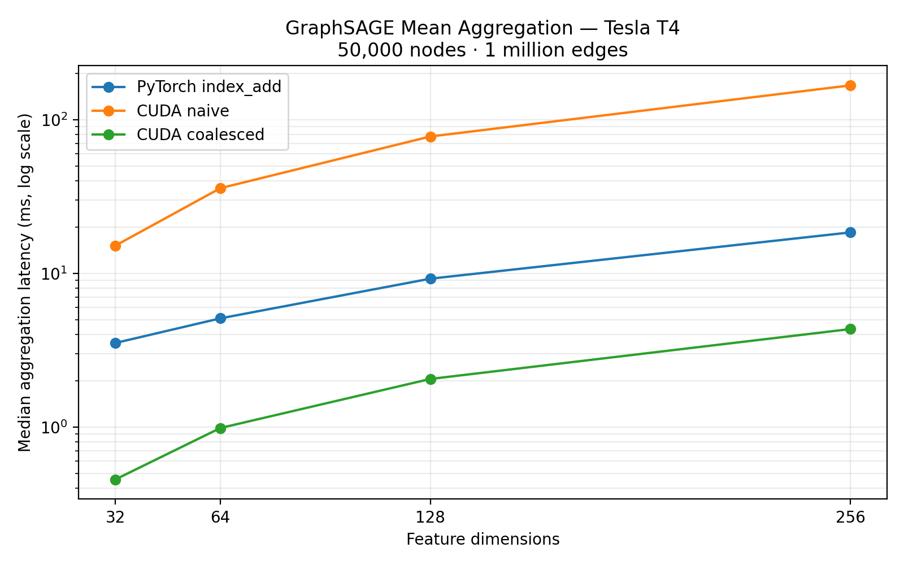

# CUDA-Accelerated GraphSAGE Mean Aggregation

A focused GPU-systems project: forward-pass neighbor mean aggregation for a
GraphSAGE layer, stored in **CSR** (compressed sparse row) format.

The project deliberately implements only the aggregation primitive:

$$h'_v = \frac{1}{|N(v)|}\sum_{u\in N(v)}h_u$$

Empty neighborhoods return zero. Duplicate neighbor entries contribute once per
entry. This primitive does not include GraphSAGE's self-feature transform.

It compares:

1. NumPy CPU reference implementation
2. PyTorch `index_add_` baseline
3. Custom CUDA C++ naive kernel (one thread per destination node)
4. Custom CUDA C++ optimized kernel (one CUDA block per node, parallel across features)

The optimized kernel makes neighboring threads read adjacent feature values from
the same source node, which is substantially more friendly to global-memory
coalescing than the naive node-parallel mapping.

## Project layout

```
src/
  aggregation.py       # CSR generation and CPU/PyTorch baselines
  cuda_extension.py    # JIT loader for the CUDA extension
  csrc/                # C++ binding and CUDA kernels
benchmarks.py          # correctness checks and timing CSV
tests/test_aggregation.py
validate_correctness.py # CPU/GPU edge-case validation without pytest
```

## Run on Kaggle (GPU T4/P100)

1. Create a Kaggle Notebook, enable **GPU** in Notebook options, then upload or
   clone this project into `/kaggle/working`.
2. In a notebook cell, run:

```bash
%cd /kaggle/working/cuda-graphsage-aggregation
!python benchmarks.py --nodes 50000 --avg-degree 20 --features 128 --runs 50
```

3. The first run compiles the extension. Keep the resulting
`results/benchmark_results.csv` and `results/benchmark_plot.png` as project
evidence. Record the GPU name shown by the script in your README before posting.

> Kaggle may have a different PyTorch/CUDA pairing over time. The extension is
> compiled against the CUDA toolkit bundled with the active Kaggle image.

## Local verification

CPU-only checks run without CUDA:

```bash
python -m pytest -q
python benchmarks.py --cpu-only
```

On a CUDA machine, use the Kaggle command above. The benchmark verifies custom
kernel outputs against the PyTorch result before timing them.

## Methodology

* Graph: deterministic synthetic CSR graph; each row has `avg_degree` sampled
  neighbors. This isolates aggregation cost from data loading and sampling.
* Metric: median aggregation-call latency using CUDA events; throughput is directed
  edges processed per second. Timings include output allocation/initialization and
  the PyTorch baseline's row construction, feature gather, reduction, and division.
  They exclude input transfers, graph generation, and extension compilation.
* Fairness: warm-up iterations precede measurement; PyTorch and custom kernels
  use the same `float32` CSR inputs and output shape.
* Scope: inference/forward pass only. Backpropagation, sampling, and fused
  linear transforms are intentionally out of scope.

## Measured results

Kaggle, October 13, 2026: one Tesla T4, PyTorch 2.11.0+cu128, PyTorch CUDA
12.8, driver 580.178.04. Each graph has 50,000 nodes and 1,000,000 directed
neighbor entries (degree 20), float32 features, graph seed 7 and feature seed 42.
GPU timings use 20 warm-up calls and the median of 50 measured calls.

| Features | NumPy CPU (ms) | PyTorch (ms) | CUDA naive (ms) | CUDA coalesced (ms) | Speedup vs PyTorch |
| ---: | ---: | ---: | ---: | ---: | ---: |
| 32 | 763.213 | 3.523 | 15.156 | 0.456 | 7.73× |
| 64 | 769.561 | 5.095 | 35.836 | 0.985 | 5.17× |
| 128 | 778.041 | 9.235 | 77.782 | 2.055 | 4.49× |
| 256 | 965.595 | 18.468 | 167.235 | 4.340 | 4.26× |



Raw measurements: [CSV](results/feature_sweep_results.csv),
[summary](results/feature_sweep_summary.csv). This sweep is one measurement run
per configuration, not a confidence interval or a comparison with optimized graph
libraries. Speedups are specific to the implemented `index_add_` baseline.

## Correctness

The Kaggle run passed 45 comparisons against the NumPy reference: three degree
patterns (all-empty, mixed, and a row with 1,000 neighbors), five feature widths
(1, 7, 33, 128, 257), and three implementations. Sampling with replacement tests
duplicate entries. Tolerances are `rtol=1e-4`, `atol=1e-4`.

Reproduce those checks on Kaggle:

```bash
python validate_correctness.py --cuda
```

For CPU/PyTorch checks locally, run `python validate_correctness.py`.

## Interpretation

* CSR keeps each destination node's neighbors contiguous in `col_indices`.
* The naive kernel has irregular node-level accesses and serial feature work.
* The block-per-node kernel distributes feature dimensions across threads, giving
  coalesced accesses for a fixed neighbor and reducing per-thread work.
* The coalesced mapping was faster in all tested configurations. The naive mapping
  was slower than PyTorch, demonstrating that custom CUDA alone does not guarantee
  faster execution.
* Performance depends on degree distribution, feature width, and GPU memory
  bandwidth. The access pattern suggests a bandwidth-sensitive workload, but no
  profiler counters were collected to establish a bottleneck.

## Same-day completion checklist

- [x] Validate CPU/PyTorch reference agreement locally
- [x] Run Kaggle GPU benchmarks and edge-case correctness checks
- [x] Save GPU environment, measured results, CSVs, and plot
- [ ] Publish the repository to GitHub
